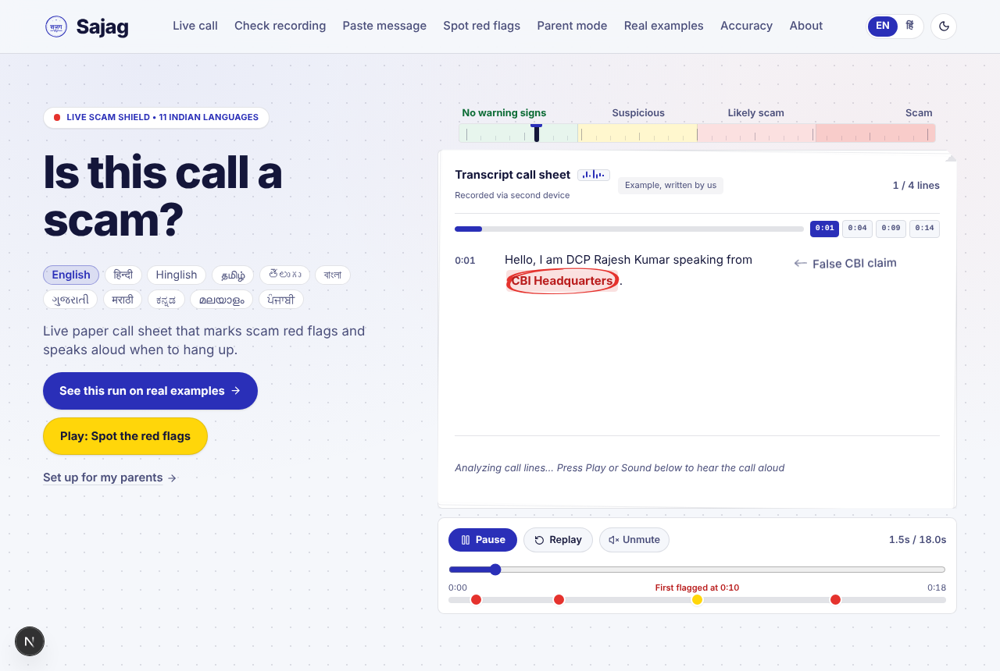
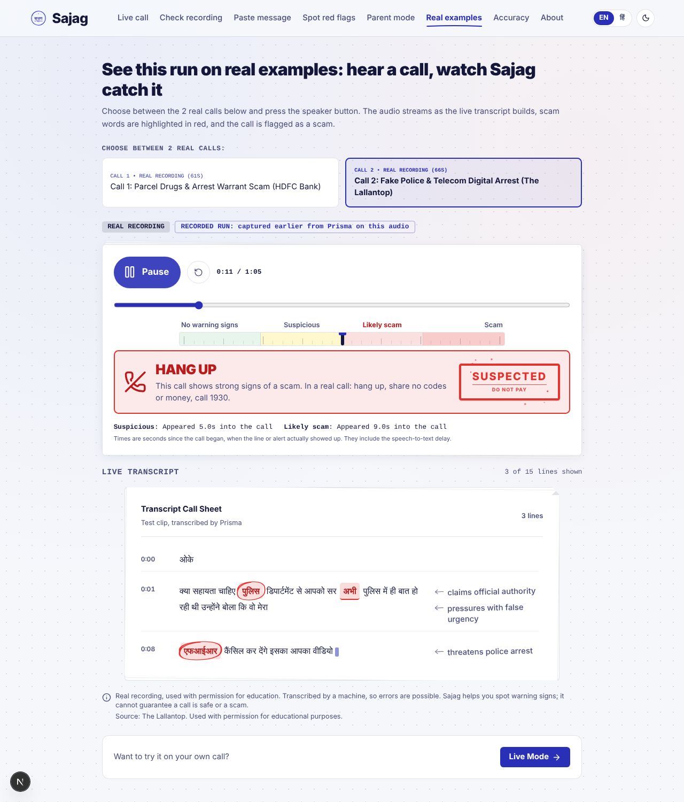
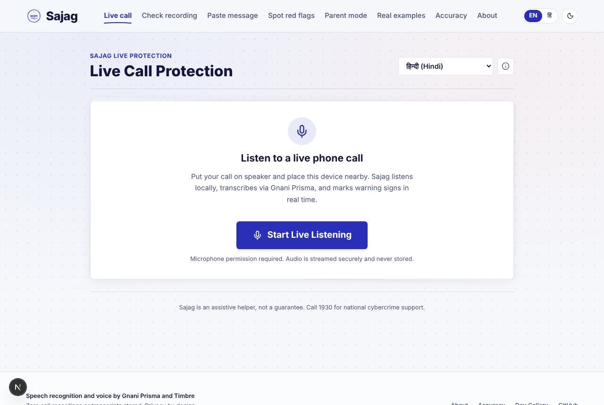
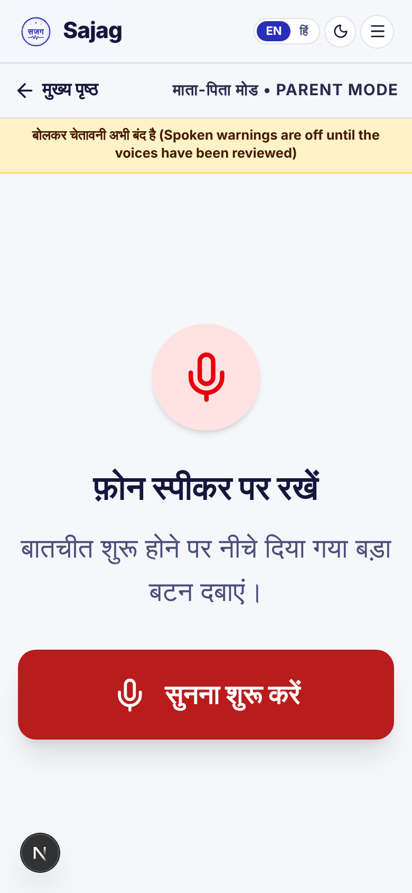

# Sajag (सजग): a scam-call shield for Indian families

> **Prototype.** Sajag listens to a suspicious phone call, **marks the warning signs on a paper-style transcript with the evidence**, and says out loud when it is time to **hang up**. It uses **Gnani Prisma** (speech-to-text) and **Gnani Timbre** (spoken warnings). The detection itself is a transparent, rule-based engine: **no LLM, no guessing, every mark points to words that were actually said.**

Built for the **Great Indian AI Internship Challenge** by Priyanshu Pratik.

| | |
|---|---|
| **Live demo (recorded examples, no sign-up)** | [https://sajag-alpha.vercel.app/test](https://sajag-alpha.vercel.app/test) |
| **One-page pitch** | [docs/PITCH.md](docs/PITCH.md) |
| **Honest accuracy and limits** | [/accuracy page](web/src/app/accuracy/page.tsx) and the section below |
| **Hosting guide** | [docs/DEPLOY.md](docs/DEPLOY.md) |

---

## The problem

"Digital arrest" and similar scams do not hack phones. They pressure a person on a call: a fake officer, a fake parcel, a fake warrant, then a demand for money and secrecy. The victim is often a parent or grandparent who has nobody listening for the pattern. By the time a relative finds out, the money has moved.

## What Sajag does

1. **Listen.** Phone audio goes to Gnani Prisma and comes back as a live transcript (Hindi, English and Hinglish are what we tested).
2. **Mark.** A rules engine compares the growing transcript to a scam playbook (authority claims, urgency, arrest threats, secrecy, money transfer, remote access, OTP requests and more). Each hit is circled on the transcript with a plain-language note such as "claims official authority".
3. **Warn.** The risk level moves `safe → suspicious → likely scam → scam`. At high risk the screen says **HANG UP**, shows a rubber-stamp verdict and can speak a short warning in Hindi or English through Gnani Timbre. A family member can be warned over WhatsApp with one tap (the message names the scam type only, never the call content).

### Screens

| Landing and recorded example | Recorded example in progress |
|---|---|
|  |  |

| Live call (microphone) | Parent mode (large text, one button) |
|---|---|
|  |  |

Other pages: **Check recording** (upload audio), **Paste message** (check an SMS or WhatsApp text), **Spot red flags** (a small game), **Accuracy** (every number below, with caveats), **About**.

---

## Try it

- **Fastest:** open the live demo link above and press the **speaker button** on one of the two examples. The call plays, the transcript builds, the evidence gets circled and the HANG UP banner appears. These are **recorded runs**: the transcripts were captured earlier by streaming the audio through the real pipeline, and each alert appears at the time it actually arrived (including the speech-to-text delay).
- **On your own call:** run it locally (below) and open `/live`. Put the call on speakerphone near the device running Sajag. Phones do not let web apps tap call audio, so a second device is required.

The two examples: (1) an HDFC Bank awareness-campaign **dramatisation** of a parcel-and-warrant scam, and (2) a news-channel recording of a fake-police "digital arrest" call (The Lallantop), used with permission for educational purposes. They are labelled as such on the page.

---

## Measured results (and what they do not prove)

Everything here comes from files in [`eval/results/`](eval/results). Read the caveats.

**1. Corpus test, 239 clips (synthetic dialogues voiced with Gnani Timbre, some with simulated telephone noise), speech → Prisma → engine.**

| Split | Clips | Scam recall | Legit flagged |
|---|---:|---:|---:|
| Overall | 239 | 76.3% (87/114) | 0 of 125 |
| Dev (tuned on) | 113 | 83.9% (47/56) | 0 of 57 |
| Test | 54 | 75.0% (21/28) | 0 of 26 |
| Holdout | 60 | 63.3% (19/30) | 0 of 30 |

Mean character error rate 9.7%. **Caveat:** the scripts and the rules were written by the same process and the speech is synthetic and cleaner than a real phone line, so these numbers are optimistic. The lower holdout recall (63.3%) is the more honest signal.

**2. Final holdout (10 new scripts, text only, run once after freezing the engine):** 5 of 5 scams flagged, **2 of 5 genuine bank/police advisories also flagged**. Genuine advisories that say "never share your OTP" use the same words scammers use, which is the known weakness. n=10 is far too small to quote a rate.

**3. Live streaming replay (10 runs through the real WebSocket pipeline at real-time pace).** 5 of 6 clean scam clips reached "likely scam" (11.8 to 24.7 seconds of audio, median 18.2 s); 1 scam clip stayed "safe" (both clean and noisy versions); both legitimate-advisory clips stayed "safe". Detection runs once per speech segment (about 6 s), so alert delay is segment length plus speech-to-text latency.

**4. The two website examples**, from the recorded runs (seconds into the call when each alert appeared): Lallantop call: suspicious 8.6, likely scam 16.1, scam 32.7. HDFC dramatisation: suspicious 12.3, likely scam 18.4, scam 30.4. In the dramatisation the second half is the narrator giving advice, which the engine can also flag.

### Known limits

- **A helper, not a guarantee.** It can miss scams and can raise false alarms. Never share OTPs, PINs or money with an unverified caller. India's cyber-crime helpline is 1930.
- **Phone call audio cannot be tapped by a web app**, so Sajag needs speakerphone and a second device. Room noise and speaker-to-microphone loss hurt recognition.
- **Genuine advisories can false-alarm** (above).
- **Tested on Hindi, English and Hinglish only.** Prisma supports more Indian languages; we have not evaluated them.
- **The spoken warning clips are machine-generated and have not yet been reviewed by a native speaker**; the app only plays them after the review flags are set ([docs/WARNING_REVIEW.md](docs/WARNING_REVIEW.md)).
- Real-recording evaluation on private audio exists as a tool ([`scripts/eval_real_audio.py`](scripts/eval_real_audio.py)); no real-world accuracy figure is claimed.

---

## How it works

```
 phone on speaker ──► browser mic ──► 16 kHz PCM16, 1,024-byte frames every 32 ms
                                        │  WebSocket /ws/live
                                        ▼
        FastAPI relay ──► Gnani Prisma streaming STT (segments of ~6 s of speech)
                                        │ transcript segments
                                        ▼
        Rules engine (data/playbook/playbook.yaml, frozen)  ── evidence quotes are exact substrings
                                        │ risk updates: safe → suspicious → likely_scam → scam
                                        ▼
        Next.js UI: circled evidence, level strip, HANG UP + stamp, Timbre warning clips, WhatsApp family alert
```

- **Backend:** Python 3.13, FastAPI. REST `/stt/v3` for uploads and WebSocket `/stt/v3/stream` for live audio; per-IP limits, daily credit caps, maintenance switch.
- **Engine:** deterministic and data-driven; advisory language ("never share your OTP") is only treated as protective when it tells the listener *not* to act, so scammers who imitate advisories are still caught. Details and decisions: [docs/DECISIONS.md](docs/DECISIONS.md).
- **Frontend:** Next.js 16, React 19, TypeScript, Tailwind 4, Hindi/English UI, light and dark themes, accessible (Lighthouse accessibility 95 to 96 on the main pages in dev; performance re-check pending on the deployed site).
- **Voice:** Gnani Timbre v2.5 (Chitra for Hindi, Kaveri for English); warnings are pre-baked MP3s so the live path never waits on synthesis.
- **Engineering notes:** the upstream streaming VAD never closes a segment on continuous speech, so the relay sets `x-max-speech-s: 6.0` and flushes with silent frames; replay pacing uses absolute deadlines so frames really go out every 32 ms.

### Static showcase on Vercel

Live at **[sajag-alpha.vercel.app](https://sajag-alpha.vercel.app)** ([recorded examples](https://sajag-alpha.vercel.app/test)). Hosting only the `web/` folder on Vercel serves `/`, `/test`, `/paste` (client-side rules engine), `/spot`, `/accuracy`, and `/about` with no backend. Routes that require the microphone, audio upload, or live speech APIs (`/live`, `/check`, `/parent`) show **"Prototype: not open for testing"** when no backend server is connected; run the FastAPI backend locally to enable them ([docs/DEPLOY.md](docs/DEPLOY.md)). To add your own clip: [docs/LIVE_TEST_CLIPS.md](docs/LIVE_TEST_CLIPS.md).

---

## Run it locally

Prerequisites: Python 3.13+, ffmpeg on PATH, Node 20.9+ (22 LTS recommended), a Gnani API key.

```bash
git clone https://github.com/Ppratik765/SAJAG.git && cd SAJAG
cp .env.example .env            # set GNANI_API_KEY=...

# backend
python -m venv api/.venv
api/.venv/bin/python -m pip install -r api/requirements.txt     # Windows: api\.venv\Scripts\python.exe
cd api && ../api/.venv/bin/python -m pytest && ../api/.venv/bin/python -m uvicorn app.main:app --port 8000

# frontend (second terminal)
cd web && npm install && npm run dev        # http://localhost:3000
```

Tests: 166 backend tests (`pytest`) and 21 frontend unit tests (`node --test tests/*.test.mjs`). Docker: `docker compose up --build`.

---

## Privacy and security

- Uploaded audio is converted in a temporary directory and deleted in a `finally` block; transcripts live only in memory during a call and are never stored.
- Logs hold event types and credit counters only: no keys, phone numbers or call content.
- Public endpoints are rate limited per IP; billable speech APIs have daily caps and a `MAINTENANCE_MODE` switch. See [SECURITY.md](SECURITY.md).

## Credits

Speech recognition (**Gnani Prisma**) and voice (**Gnani Timbre**) by [Gnani.ai](https://gnani.ai). Example call audio: The Lallantop and HDFC Bank's awareness campaign, used with permission for educational purposes; ownership remains with the original creators.

## License

MIT, see [LICENSE](LICENSE).
